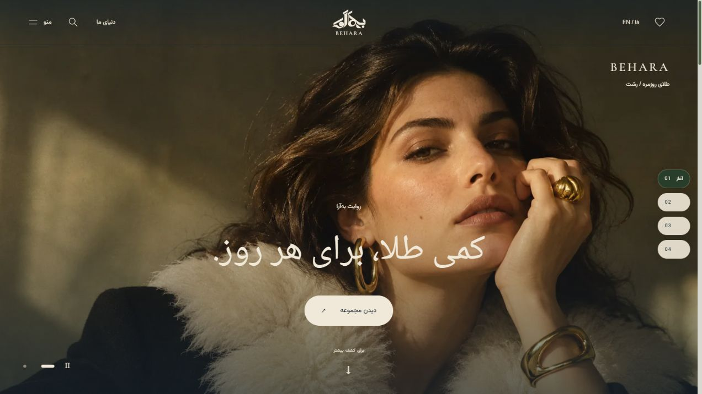
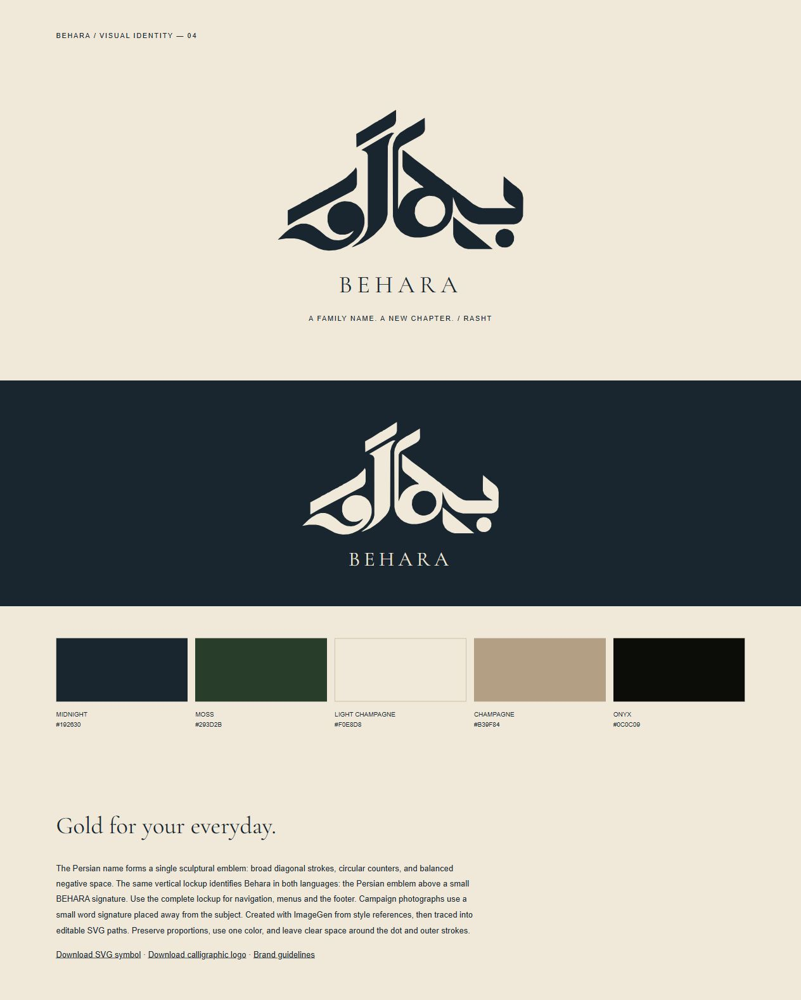
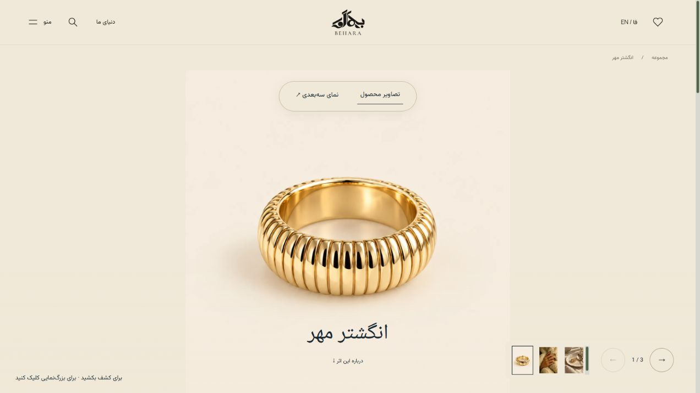
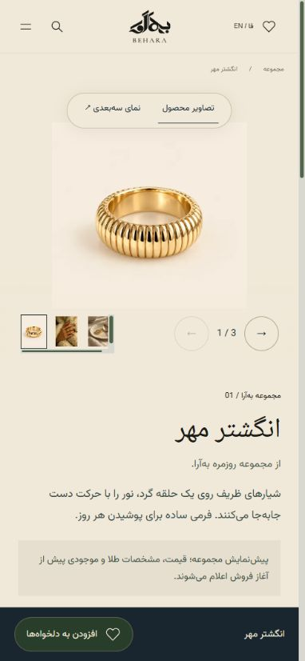

# BEHARA / به‌آرا

An editorial jewelry gallery and Persian brand identity for a family business taking shape in Rasht, Iran. Behara brings together a calligraphic logo, a restrained color system, bilingual storytelling, product discovery, and an optional 3D experience.

**Scope:** brand identity · logo design · art direction · UI/UX · frontend development · local content management.



## The design

The Persian name becomes the central emblem, paired with a supporting Latin signature. The same vertical lockup works across English and Persian interfaces. Midnight blue and moss green anchor the website, with champagne backgrounds and gold imagery providing contrast.

| Color | Hex | Role |
| --- | --- | --- |
| Midnight blue | `#192630` | Brand sections, navigation and footer |
| Moss green | `#293D2B` | Actions, selection states and brand storytelling |
| Light champagne | `#F0E8D8` | Product backgrounds and reading surfaces |
| Champagne | `#B39F84` | Supporting accents and borders |
| Onyx | `#0C0C09` | Dark image viewing surfaces |

Typography combines Cormorant Garamond, Manrope, Vazirmatn and the bundled Persian editorial face. Editorial campaigns use a vintage photographic direction; product galleries start with clean studio mockups.

[Explore the identity assets](public/brand/) · [Logo SVG](public/brand/behara-logo-v3.svg) · [Brand guidelines](public/brand/identity-v3.md)



## Experience

- **English and Persian:** RTL layouts, localized copy, persistent language preference and an animated language transition.
- **Campaign journey:** rotating photographs, manual selection, pause, scheduling, focal-point control, scroll reveals and chapter navigation.
- **Collection discovery:** categories, search, related pieces and dedicated product URLs.
- **Wishlist:** browser-local selections, individual removal, copy-to-share and text-file download. No customer account required; selections do not reserve stock or create orders.
- **Photography first:** responsive images, thumbnails, drag navigation, keyboard controls and full-screen enlargement.
- **Optional 3D:** Three.js is imported only after choosing the 3D view. Uploaded GLB models preserve their materials or can use a gold material override. Procedural design studies are available as presets.
- **Responsive product pages:** compact mobile galleries, larger touch targets and a persistent wishlist action.
- **Reduced motion:** animated transitions and auto-rotation respect the visitor's preference.



<p align="center"></p>

## Local studio

The React management workspace at `/admin/` includes:

- First-run account setup, server-checked login and sign-out.
- Product creation, editing, search, category/status filters and bulk publish/hide/delete controls.
- Recoverable trash for products and campaigns.
- Price, stock, weight, gold purity, size, dimensions, SKU and bilingual descriptions.
- Image upload, ordering, roles and alt descriptions.
- Self-contained GLB upload, replacement, removal and an on-demand 3D preview.
- Campaign playlist management and editing for five homepage content sections.
- JSON import/export, automatic save backups and revision checks to prevent stale tabs overwriting newer content.

Passwords are stored as salted scrypt hashes. Management requests require a local loopback connection; writes require the same origin. Sessions use an HTTP-only, SameSite cookie. Private account data, full draft content and backups live in `.studio/`, which is excluded from Git and denied by Vite's file server. The public content snapshot excludes drafts and trash.

## Run locally

Use a Node.js version supported by Vite 6, then:

```sh
npm ci
npm run dev
```

Open **http://127.0.0.1:5174/**. Visit **http://127.0.0.1:5174/admin/** to choose your first admin username and password. No account or password is included in this repository.

```sh
npm run build
npm run preview
npm test
```

The preview command serves the static production build. Admin editing and login require `npm run dev`; they are supplied by the local Vite middleware, not by the static build.

## Deploying

`npm run build` writes the public gallery to `dist/`. Configure your host to send direct requests such as `/pieces/01` and `/wishlist` to `index.html`.

A public deployment needs a production backend for authenticated administration, uploads and persistent content. The current management API intentionally accepts loopback access only. There is no checkout, payment service or production ordering flow.

Before a commercial launch, replace concept images and preset geometry with matching inventory photography and accurate product models, then enter verified prices and specifications. Unconfirmed product data is shown as pending rather than invented.

## Project structure

```text
src/                    React gallery, wishlist, admin and lazy 3D viewer
src/base/               Theme and motion foundation adapted from Benico
src/assets/editorial/   Generated image originals and prompt records
src/assets/fonts/       Bundled fonts and their license files
public/images/          Responsive WebP derivatives
public/brand/           Logo SVGs, identity board and brand documentation
public/content/         Published gallery snapshot
public/uploads/         Uploaded product and campaign photographs
public/models/          Uploaded GLB assets (created on demand)
scripts/                Local studio API, validation, tests and asset preparation
docs/screenshots/       Website and brand identity screenshots
.studio/                Private local content, account and backups; ignored by Git
```

To regenerate responsive images, install Python and Pillow, then run `python scripts/prepare-images.py`. Prebuilt image derivatives are already committed, so Python is not required to run the website.

## Asset provenance and credits

The visual identity combines an AI-assisted calligraphic concept with SVG contour tracing and a consistent layout system. Campaign and mockup images were created with the built-in ImageGen tool; prompt records are retained with the assets. These visuals describe a concept collection and are not evidence of physical inventory. The logo is a design concept, not a claim of trademark registration.

The theme and motion foundation draws from the author's Benico project; the language curtain draws from the author's portfolio. Behara has its own palette, content, identity and jewelry-specific interactions. Bundled font licenses are included in `src/assets/fonts/`. Mood references and private local files are deliberately excluded from the repository.
